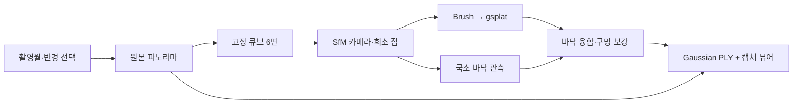

# Google Street View Gaussian

**Google 스트리트뷰를 촬영월별로 수집하고, Gaussian 공간과 이미지 작업용 뷰어로 연결하는 실험 도구입니다.**

[English](README.en.md) · [GPU 구성](docs/GPU_SETUP.md) · [실험 기록](docs/EXPERIMENT.md) · [입출력 구조](docs/DATA_FORMAT.md)

Google 스트리트뷰 실험에서 사용한 재구성, 바닥 보강, 파노라마 추출, PNG 캡처 코드를 명령줄 도구로 정리했습니다. GPU 재구성은 별도 설치한 [streetview-to-ply](https://github.com/tardis7732/streetview-to-ply)의 SfM → Brush → gsplat 백엔드를 사용합니다.

## 할 수 있는 일

- **촬영월 고정 수집:** 중심·반경·`YYYY-MM`을 지정합니다. 해당 월 촬영본만 학습에 넣고 다른 월로 보충하지 않습니다. 메타데이터 조회 한도와 제외된 지점을 기록합니다.
- **여러 촬영 지점의 Gaussian 재구성:** 파노라마를 고정된 90° 큐브 6면으로 바꾸고, 실제 영상 대응점으로 카메라와 희소 점을 복원합니다. Brush 40,000단계 뒤 gsplat 6,000단계로 추가 학습합니다.
- **바닥 융합·작은 구멍 보강:** 도로 관측점으로 국소 높이를 맞추고 원본 사진의 색을 재투영합니다. 작은 빈 영역은 주변 바닥을 보간해 추가합니다. 기존 혼합본의 바닥을 공통 카메라로 정렬해 사용할 수도 있습니다.
- **이미지 정리용 뷰어:** 가우시안 PNG와 가장 가까운 원본 스트리트뷰 PNG를 같은 시선·화각·해상도로 저장합니다. 가운데 **두 장 저장**은 두 PNG를 Downloads 폴더에 함께 저장합니다. ZIP을 만들지 않습니다.
- **사진 픽셀 기반 파노라마:** 기존 큐브 또는 보관한 파노라마를 재투영합니다. 반대편 파노라마, 2:1/2.5:1 등의 비율, 원본 픽셀을 그대로 유지하는 중앙 크롭을 지원합니다. 이 단계에 이미지 생성 모델은 사용하지 않습니다.



## 설치

Python 3.11 이상으로 CPU 도구·뷰어를 사용할 수 있습니다. Google 수집 어댑터는 Python **3.12 이상**, 전체 재구성은 Linux/WSL2의 CUDA 환경이 필요합니다.

```bash
git clone https://github.com/tardis7732/google-streetview-gaussian.git
cd google-streetview-gaussian
python -m pip install -e .
python -m google_streetview_gaussian --help
```

Google 수집·도로 라벨 어댑터는 [YellowO2/streetview-to-3d](https://github.com/YellowO2/streetview-to-3d)의 지정 커밋을 사용합니다. Python 3.12 환경에서 설치합니다.

```bash
python -m pip install -e ".[google]"
```

이 저장소에는 원본 스트리트뷰 사진, 학습된 PLY, 모델 가중치, SSH 접속 정보가 포함되지 않습니다. 실행 데이터는 `runs/`에 보관하며 Git에서 제외됩니다.

## 이미 있는 파노라마를 2.5:1로 만들기

사진이나 기존 큐브 데이터만 사용합니다.

```bash
# 3:1 이미지의 좌우를 잘라 정확한 2.5:1로 저장: 리사이즈·생성 없음
python -m google_streetview_gaussian crop \
  --image panorama_full.png --output panorama_2p5.png --aspect 2.5

# 원본 파노라마 → 고정 큐브 → 반대편 원통형 파노라마
python -m google_streetview_gaussian panorama \
  --image original_panorama.jpg --output opposite.png \
  --width 3840 --aspect 2.5 --hfov 225 --yaw 180 --bottom 30

# 준비된 실제 큐브 파일을 직접 읽기
python -m google_streetview_gaussian panorama \
  --cube-manifest runs/area/reconstruction/prepared/manifest.json \
  --pano-id YOUR_PANO_ID --output from_cube.png \
  --aspect 2.5 --hfov 225
```

위 예시는 Bash 줄바꿈입니다. PowerShell에서는 한 줄로 실행하거나 줄바꿈 기호를 백틱으로 바꾸세요. `--hfov`는 가로 시야각, `--yaw`는 **원본 파노라마의 정면에 대한 각도**이며 지리적 방위각이 아닙니다. `--bottom`은 수평선 아래로 남길 각도입니다. 출력 JSON에 원본 해시와 투영값을 기록합니다. 일반 사진에 HDR 밝기 정보가 추가되지는 않습니다.

## Google 스트리트뷰에서 Gaussian 만들기

먼저 [GPU 구성](docs/GPU_SETUP.md)에 따라 별도 백엔드와 모델을 설치하세요. `YOUR_PANO_ID`, 위도·경도, 경로는 원하는 입력으로 바꿉니다.

```bash
python -m google_streetview_gaussian collect --run runs/area \
  --seed-pano YOUR_PANO_ID --lat 35.0 --lon 139.0 \
  --radius 100 --month 2025-09
python -m google_streetview_gaussian download --run runs/area
python -m google_streetview_gaussian prepare --run runs/area

python -m google_streetview_gaussian sfm --run runs/area \
  --backend ../streetview-to-ply
python -m google_streetview_gaussian train --run runs/area \
  --backend ../streetview-to-ply --brush /path/to/brush_app

python -m google_streetview_gaussian labels --run runs/area
python -m google_streetview_gaussian ground --run runs/area
python -m google_streetview_gaussian hybrid --run runs/area
python -m google_streetview_gaussian repair --run runs/area

python -m google_streetview_gaussian export --run runs/area \
  --model runs/area/holefix/model.ply --output runs/viewer
python -m google_streetview_gaussian viewer --data-dir runs/viewer
```

바닥 보강이 필요 없으면 학습 후 `reconstruction/training/refined/final.ply`를 직접 내보낼 수 있습니다. 기존 혼합본의 바닥을 추가하려면 `ground --legacy /path/to/previous_hybrid`를 지정합니다. 공통 촬영 지점 3개 이상과 해당 혼합본의 `manifest.json`이 필요합니다.

기본 SfM 등록률은 **100%**입니다. 일부 촬영본이 연결되지 않으면 실패합니다. 제외를 명시적으로 허용할 때만 `sfm --minimum-coverage 0.85`처럼 지정하세요. 등록되지 않은 촬영 지점은 내보낸 manifest에 기록됩니다. 실패한 SfM 작업 폴더를 덮어쓰지 않으므로 새 작업 폴더에서 다시 실행해야 합니다.

## 이미지 작업용 뷰어

```bash
python -m google_streetview_gaussian viewer --data-dir runs/viewer --port 8870
```

- **가우시안 PNG / 스트리트뷰 PNG:** 각 이미지를 브라우저 다운로드로 저장합니다.
- **두 장 저장:** 현재 카메라를 고정하고 같은 해상도의 두 PNG를 로컬 Downloads 폴더에 함께 저장합니다. 브라우저의 연속 다운로드 제한에 의존하지 않습니다.
- **원본 촬영 위치로 이동:** 시선을 유지한 채 가장 가까운 실제 파노라마 위치로 이동합니다.
- **H:** UI 숨김/표시. PNG 내보내기에는 UI가 포함되지 않습니다.
- 현재 화면 또는 긴 변 1920/2560/3840px로 저장하며 화면 비율을 유지합니다.

원본은 가장 가까운 **실제 촬영 지점**에서 가져옵니다. 시선과 화각은 맞추지만 가상 카메라와 원본 카메라의 위치가 다르면 시차가 남습니다. 거리를 화면에 표시합니다. 서버는 `127.0.0.1`에만 바인딩하며 이미지를 외부 생성 서비스에 전송하지 않습니다. 렌더러 모듈은 고정 버전 CDN에서 읽습니다.

## 한계와 검증 범위

- 실험 도구이며 모든 장소에서 재구성이나 구멍 제거가 보장되지는 않습니다. 촬영본의 겹침·왜곡·차량 움직임에 영향을 받습니다.
- 바닥 구멍을 보간한 부분은 **추정 표면**입니다. 관측되지 않은 실제 지형을 새로 측정한 결과가 아닙니다. 색도 가려진 곳에서는 주변 도로색을 보간합니다.
- 사람·차량·하늘을 지우는 학습 마스크는 사용하지 않습니다. 도로 라벨은 바닥 선택에, 보호 라벨은 사람·차량·하늘을 정리 대상에서 제외하는 데 사용합니다.
- 수집 반경과 최종 모델 자르기는 다릅니다. 이 레시피는 최종 모델에 별도 반경 자르기를 적용하지 않습니다.
- 공개 패키지의 CPU 테스트에는 실제 사진 없는 합성 데이터와 로컬 HTTP 저장 검증을 사용합니다. **GPU 전체 재구성은 이번 패키지 정리 후 새 환경에서 재실행하지 않았습니다.** 작업에 사용한 H200 실험 결과와 구분해 [실험 기록](docs/EXPERIMENT.md)에 적었습니다.

## 개발·검증

```bash
python -m pip install -e ".[dev]"
python -m pytest -q
python -m build
```

기여 코드는 이 저장소에서 관리하며 외부 백엔드·모델·라이브러리는 각 프로젝트에서 설치합니다. 출처는 [NOTICE](NOTICE.md)에 정리했습니다. 이 저장소의 재배포 라이선스는 아직 별도로 지정하지 않았습니다.
